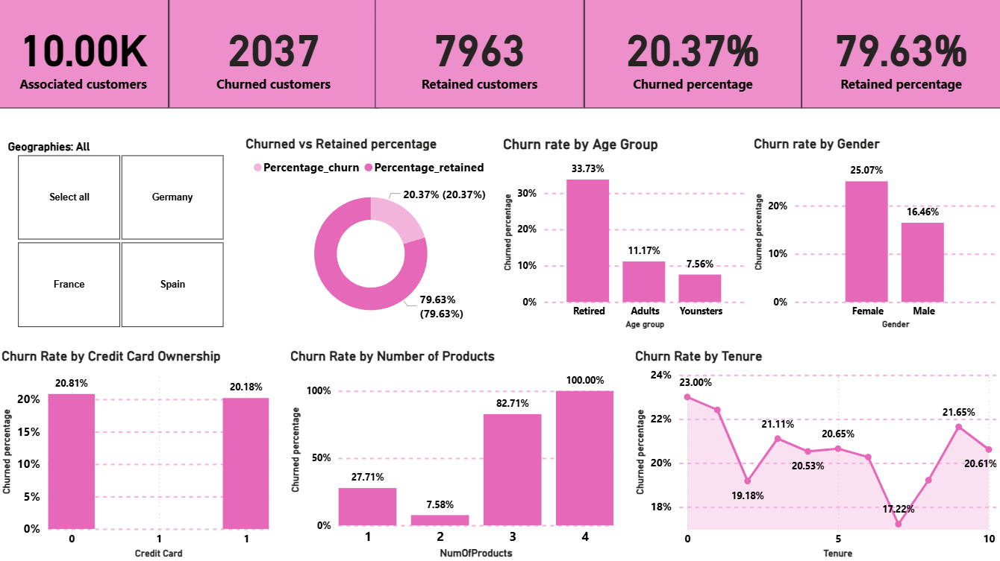

# Bank Customer Churn Analysis

## Project Overview

Customer churn is a significant challenge for banks, as losing customers can affect revenue, customer relationships, and long-term business growth.

This project focuses on analyzing bank customer data to understand customer churn patterns, identify customer segments associated with higher churn, and uncover insights that can help improve customer retention.

The analysis was performed using Python in Jupyter Notebook, followed by data analysis and visualization to understand customer behavior and churn-related factors.

## Business Objectives

- Analyze customer churn and retention patterns.
- Identify customer segments with higher churn.
- Investigate the relationship between churn and customer characteristics.
- Analyze factors such as age, tenure, geography, account activity, and product usage.
- Generate actionable insights to support customer retention strategies.

## Tools & Technologies

- Python
- Pandas
- NumPy
- Matplotlib
- Seaborn
- Jupyter Notebook
- Power BI

## Project Workflow

1. Data Understanding
2. Data Cleaning and Preprocessing
3. Exploratory Data Analysis (EDA)
4. Business Analysis
5. Customer Churn Insights
6. Power BI Dashboard

## Key Insights Section 

1. Overall customer churn rate is 20.37%.
2. Female customers have a higher churn rate than male customers.
3. Customers with 3 or 4 banking products show significantly higher churn rates; these segments should be investigated further, especially considering their customer counts.
4. Retired customers show higher churn compared to other age groups.
5. Credit card ownership shows very little difference in churn rate.

## Project Structure

- `data/` – Raw and processed datasets
- `notebooks/` – Jupyter notebooks covering the analysis

## Project Status

Project Status: Completed — Data analysis, business insights, and Power BI dashboard development.
